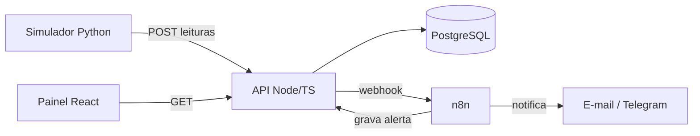

# Plataforma de Monitoramento Industrial

**Em desenvolvimento.** Início em 19/10/2026, versão 1.0 prevista para 18/12/2026.

Plataforma que recebe leituras **simuladas** de máquinas (temperatura, vibração e status), guarda o histórico em um banco de dados, gera alertas quando um valor passa do limite e mostra tudo em um painel que se atualiza a cada poucos segundos.

## Por que este projeto

Tenho interesse em automação industrial há bastante tempo e, depois de concluir o curso de sensoriamento inteligente para a indústria (VIRTUS/EMBRAPII), quis colocar em prática o que aprendi sobre coletar, guardar e visualizar dados de sensores.

Também queria juntar em um só projeto o que venho estudando em desenvolvimento web: API, banco de dados, painel e automação com n8n. Como não tenho acesso a máquinas reais, uso dados simulados.

O objetivo é aprender construindo, com um problema próximo da realidade de uma fábrica: perceber cedo que uma máquina está saindo do normal, antes de ela parar a produção.

## Funcionalidades planejadas (v1.0)

- Lista de máquinas com status atual
- Gráfico das leituras ao longo do tempo
- Alertas automáticos por e-mail ou Telegram
- Reconhecimento de alertas no painel
- Login com JWT

O escopo completo está em [docs/escopo.md](docs/escopo.md).

## Arquitetura


## Modelo de dados

[Diagrama entidade-relacionamento](docs/modelo-de-dados.png)

O código-fonte do diagrama está em [docs/modelo-de-dados.dbml](docs/modelo-de-dados.dbml).

## Stack

| Camada | Tecnologia |
|---|---|
| Banco de dados | PostgreSQL |
| API | Node.js, TypeScript, Express |
| Painel | React, TypeScript, Tailwind CSS |
| Simulador | Python |
| Automação | n8n |
| Infraestrutura | Docker Compose |

## Como rodar

## Como rodar o banco (desenvolvimento)

Com o Docker Desktop aberto, na pasta do projeto:

```bash
docker run --name monitor-db -e POSTGRES_PASSWORD=dev -e POSTGRES_DB=monitoramento -p 5432:5432 -v "$(pwd)/sql:/docker-entrypoint-initdb.d" -d postgres:16
```

Para conferir as tabelas:

```bash
docker exec -it monitor-db psql -U postgres -d monitoramento -c "\dt"
```

Para recomeçar do zero: `docker rm -f monitor-db` e repita o primeiro comando.

## Roadmap

Acompanhe o andamento no [quadro do projeto](https://github.com/users/F0RT-DEV/projects/2).

## Autor

**Douglas Ferreira Borges**
[LinkedIn](https://www.linkedin.com/in/douglas-f-borges) · [GitHub](https://github.com/F0RT-DEV)